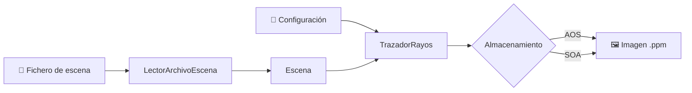

<div align="center">

# 🎨 Ray Tracer 3D

### Motor de trazado de rayos de alto rendimiento en C++

*Simulación física de la luz, pensada para exprimir la microarquitectura y ahorrar energía.*


</div>

---

## 📖 Sobre el proyecto

Motor de **trazado de rayos 3D** desarrollado en C++ como proyecto de la asignatura **Arquitectura de Computadores** (curso 2025-26) en la **Universidad Carlos III de Madrid (UC3M)**.

El renderizador simula cómo la luz rebota en un entorno tridimensional con **esferas** y **cilindros** de distintos **materiales**, y genera imágenes en formato `.ppm` (RGB, valores 0-255). El foco está en la **programación orientada al rendimiento** y la **eficiencia energética**.

## 🖼️ Galería

<div align="center">

| | | |
|:---:|:---:|:---:|
|  |  |  |

</div>

---

## 👥 Autores

| Autor |
|---|
| María Arias Rodríguez |
| Jorge Ignacio Castañeda Vallenilla |
| Ana Díaz Jiménez |
| Jaime Sánchez Sánchez |

**Grupo:** 81 · **ID de grupo:** M81-01 · **Universidad:** Universidad Carlos III de Madrid (UC3M)

---

## ✨ Características

- 🔮 **Geometrías:** esferas y cilindros con intersecciones analíticas.
- 🪞 **Materiales:** mate, metálico y refractivo (cristal, según la ley de Snell).
- 🎲 **Anti-aliasing Monte Carlo** con generador Mersenne Twister.
- 📷 **Cámara configurable:** posición, dirección, campo de visión y relación de aspecto.
- 🌅 **Cielo con degradado** y semillas aleatorias reproducibles.
- 🗂️ **Dos layouts de memoria** intercambiables: AOS y SOA.
- 📄 **Escenas en texto plano** leídas por un parser propio.

---

## 🏛️ Arquitectura

El motor se organiza en **8 capas de abstracción**:

| # | Capa | Componentes | Responsabilidad |
|:-:|---|---|---|
| 1 | **Matemáticas y núcleo aleatorio** | `Vector`, `Mersenne Twister` | Suma, resta, producto escalar y vectorial, normalización. Números pseudoaleatorios para Monte Carlo y anti-aliasing |
| 2 | **Modelado geométrico** | `Rayo`, `Intersección` | Trayectoria de la luz y gestión de colisiones (punto de impacto, normal y distancia `t`) |
| 3 | **Primitivas** | `Esfera`, `Cilindro` | Colisión específica de cada figura |
| 4 | **Materiales** | `Mate`, `Metal`, `Refractivo` | Reflexión difusa, reflexión tipo espejo con dispersión ajustable y refracción física |
| 5 | **Cámara y configuración** | `Configuración`, `Geometría`, `TamañoVentana` | Resolución, calidad, semillas, cielo, posición y orientación de la cámara |
| 6 | **Escena** | `Escena`, `LectorArchivoEscena` | Colección de objetos 3D, impacto más cercano y parser de escenas |
| 7 | **Motor de renderizado** | `Ventana`, `TrazadorRayos` | Varios rayos por píxel, trazado de rebotes y promediado de color |
| 8 | **Almacenamiento** | `AOS`, `SOA` | Estrategias de organización de los píxeles en memoria |

Cada rayo se define de forma paramétrica:

$$P(\lambda) = \text{Origen} + \text{Dirección} \cdot \lambda$$

### 🔄 Flujo de datos



### 🗂️ AOS vs SOA

```text
AOS  (Array of Structures)   [RGB][RGB][RGB][RGB] ...
SOA  (Structure of Arrays)   [RRRR...][GGGG...][BBBB...]
```

---

## 🚀 Optimizaciones de rendimiento

Durante el desarrollo se aplicaron técnicas orientadas a la microarquitectura:

- 🧠 **Menos punteros, menos fallos de caché:** las referencias a objetos y materiales se sustituyeron por estructuras contiguas en vectores planos (`struct` unificados de esferas y cilindros). Resultado: menos *LLC-misses* (fallos de caché L3) y mejor localidad espacial.
- ⚡ **Inlining y métodos fijos:** optimización del Mersenne Twister, que se invoca con muchísima frecuencia para la dispersión de rayos por píxel.
- 🔬 **Análisis de disposición de memoria:** la variante **AOS** logró una eficiencia energética entre un **5 % y un 7 % superior** (~680-711 M inst/J), con menos tiempo de ejecución y menos fallos de caché que **SOA**.

---

## 📊 Evaluación y métricas

Medido en Linux con `perf stat` sobre **4 escenarios** de complejidad creciente.

| Métrica | Resultado | Lectura |
|---|:---:|---|
| **IPC** (instrucciones por ciclo) | ~2.0 – 2.16 | Excelente aprovechamiento del pipeline |
| **Branch-misses** | 0.13 % – 0.62 % | Predicción de saltos muy fiable |
| **Uso de CPU** | 99 % – 100 % | Aplicación *CPU-bound*, no limitada por I/O |
| **Fallos LLC** | ≈ 0.09 LLC / M inst | La escena cabe eficientemente en las cachés |
| **Eficiencia energética (AOS)** | ~680 – 711 M inst/J | 5 % – 7 % mejor que SOA |

---

## 🧪 Pruebas y validación

Suite de testing automatizada mediante scripts de Python:

| Tipo | Cantidad | Alcance |
|---|:---:|---|
| **Unitarias** (Google Test / C++) | **92** | 100 % de los componentes principales: `Vector`, `Rayo`, `Materiales`, `Escena`, `AOS`, `SOA` |
| **Funcionales** | **11** | Esferas básicas, cilindros, materiales combinados, refracciones complejas y errores por ficheros inexistentes |

---

## ⚙️ Compilación y ejecución

### Requisitos

- Compilador con soporte **C++17** o superior (`g++` o `clang++`)
- **Linux** (recomendado para recoger métricas con `perf`)
- Herramientas sugeridas: `make` / `cmake`, `clang-tidy`

### Uso

```bash
# 1. Compilar el proyecto
make

# 2. Ejecutar el renderizador
./raytracer <fichero_configuracion.txt> <fichero_escena.txt> <fichero_salida.ppm>
```

| Argumento | Descripción |
|---|---|
| `fichero_configuracion.txt` | Resolución, calidad, semillas y cielo |
| `fichero_escena.txt` | Objetos, materiales y cámara en texto plano |
| `fichero_salida.ppm` | Imagen resultante |

---

## 📄 Licencia

Proyecto desarrollado para el entorno académico de la **Universidad Carlos III de Madrid (UC3M)**.

<div align="center">

<sub>Readme hecho por gemini.</sub>

</div>
